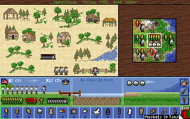
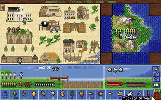
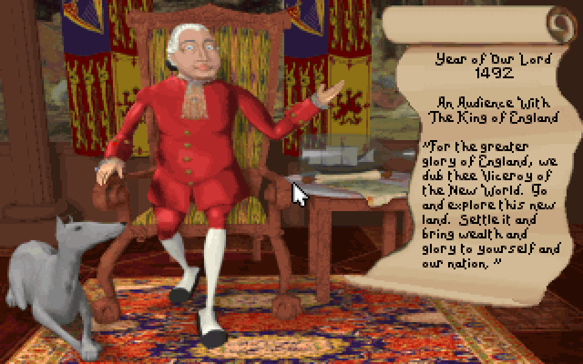
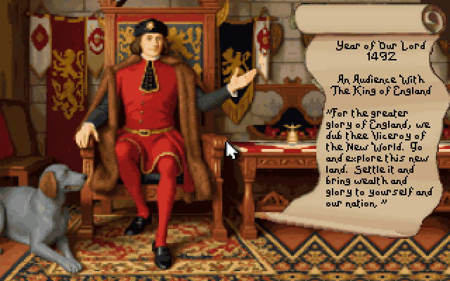
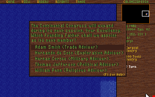
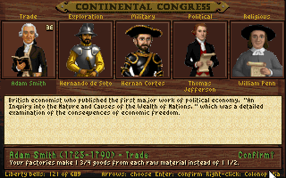

# Colonization+

Colonization+ is a mod for Sid Meier's Colonization (the DOS game, version 3.0). It keeps the original 320x200 look
and adds new European powers, native tribes, professions, buildings, advisers, interface improvements and many
fixes. See [CHANGELOG.md](CHANGELOG.md) for what each release changed.
[RELEASES.md](RELEASES.md) is the full release history, from rel1 on, including the internal test builds
that were not published.

## Showcase

- **Eight European powers and twelve native tribes.** Portugal, Russia, Denmark and Sweden join the original four, each with its own bonus, unique unit, monarch and throne room; the Inuit, Haida, Mapuche and Guarani join the tribes.
- **65 Founding Fathers in a Continental Congress.** 40 new fathers, all drawn full length, are elected into seven Congress offices that unlock foreign trade, factories, Continentals and the Declaration.
- **Six new production chains.** Dye, Naval Stores, Chocolate, Jewellery, Trade Goods and Coinage, with their crops, experts and three building levels each, shown in a colony screen split into two quarters.
- **A War of Independence for every power.** Rivals stay in the game, computer powers face their own Royal Expeditionary Force, and an Audience with the King can win independence peacefully.
- **Bigger worlds.** Small, Normal and Large maps up to 70 x 90, a Large Americas drawn from real geography, fog of war, and four seasons a year from 1700.
- **Better tools for long games.** Trade routes with 8 stops, rebuilt advisers, unlimited saves, a jukebox for your own MIDI music, and hot-seat play for up to eight people on one PC.

| Original | Colonization+ |
| --- | --- |
|  |  |
|  |  |
|  |  |

The colony screen, the 1492 audience for an English player, and the choice of the next Founding Father.

[Full Showcase](https://claude.ai/artifact/62NWUPvCgqhVpGCwXdvDPR)

## Download and install

Each release on the [Releases](../../releases) page has one Windows patcher, `ColonizationMod-relNN-Patcher.exe`.

1. You need your own copy of Sid Meier's Colonization from GOG or Steam, installed, and Windows 10 or 11.
2. Close the game, run the patcher and pick your Colonization folder (the one that contains the MPS folder).
3. Click Patch. Allow it to set three DOSBox options (xms=true, umb=true, ems=false): the mod needs them.
4. Start the game as usual from GOG Galaxy or Steam.

The patcher checks every game file against the original before changing anything, copies the originals it
replaces into COLMOD_BACKUP inside the game folder, and can restore them. Windows SmartScreen may warn about an
unknown program the first time: choose "More info", then "Run anyway".

## What is not included

The releases contain only the mod's changes. They do not contain the game: you need your own installed copy.
Sid Meier's Colonization is a trademark of its owners; this is an unofficial fan project.
